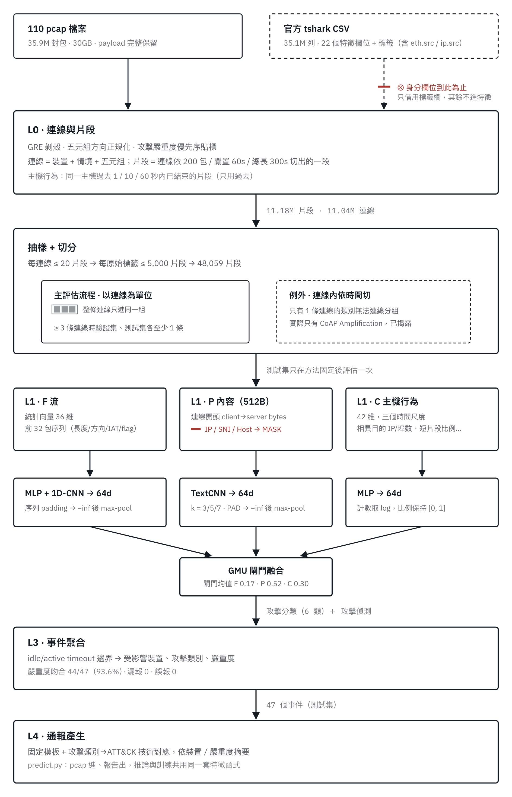

# 多模態深度學習之物聯網入侵偵測系統

碩士論文專案。從原始 pcap 出發，判斷 IoT 網路流量是否為攻擊、屬於哪一類攻擊，
再把結果聚合成資安事件並產出通報。

研究的起點是分析公開資料集上的高分從何而來：在官方特徵中只移除 IP、MAC、檢查碼與埠號，
macro F1 就從 0.979 降到 0.637，而只用 IP 或埠號單獨就能達到 0.78 左右。本專案在特徵層與
資料切分上都排除這類線索，並在這個較嚴格的條件下評估模型。

資料集：Gotham Dataset 2025（[10.5281/zenodo.14502760](https://doi.org/10.5281/zenodo.14502760)，CC-BY-4.0），
78 台模擬 IoT 裝置、110 個 pcap、約 3,600 萬個封包。



## 主要結果

測試集，5 個隨機種子的平均與標準差。資料以**連線**為單位切分，同一條連線不會同時出現在訓練與測試。

| 模型 | 攻擊分類 macro F1 |
|---|---:|
| **本系統（流量 + payload + 主機行為，GMU 融合）** | **0.985 ± 0.009** |
| Random Forest（F+C 表格特徵） | 0.965 ± 0.007 |
| XGBoost（F+C 表格特徵） | 0.959 |
| FS-Net（INFOCOM 2019） | 0.957 ± 0.008 |

- **加密的影響**：只用 payload 時，明文 Telnet 的 C&C 流量辨識率 100%，TLS 加密的 C&C 為 0%，
  加密流量需要靠流量特徵與主機行為辨識。
- **事件層**：測試集 47 個真實事件全部找到、無誤報，其中 44 個（93.6%）嚴重度判斷正確。
- **部署效能**（Apple M5 CPU）：單一片段延遲 0.61 ms、每秒約 3,500 個片段、模型 0.97 MB。
- **限制**：換到沒見過的裝置（留一裝置測試）時平均 macro F1 約 0.80；只判斷「是不是攻擊」時，
  本系統與其他監督式方法相當，優勢在攻擊分類。

每個數字都對應 `results/` 中的一份 JSON，內含產生時的設定快照與輸入檔雜湊。

## 快速開始：從 pcap 產生通報

```bash
pip install -e .
python scripts/predict.py --pcap capture.pcap --checkpoint models/S3_fpc_gmu.pt --out report.md --cpu
```

輸出為 Markdown 通報，包含各事件的時間範圍、攻擊類別與對應的 MITRE ATT&CK 技術。
範例見 [`results/reports/S3_pred_report_test.md`](results/reports/S3_pred_report_test.md)。

## 系統架構

| 層 | 內容 |
|---|---|
| L0 | 解析 pcap（含 GRE 剝殼），切成連線與片段，以時間戳 + 封包長度對齊官方標籤 |
| L1 | 三個模態：**F** 流量統計與前 32 包序列、**P** 連線開頭 512 bytes（IP / SNI / Host 已遮罩）、**C** 來源主機過去 1 / 10 / 60 秒的行為 |
| L2 | MLP + 1D-CNN、TextCNN、MLP 三個編碼器，以 Gated Multimodal Unit 融合，分類頭 + 偵測頭 |
| L3 | 同裝置連續的攻擊片段依 idle / active timeout 聚合成事件 |
| L4 | 固定模板 + ATT&CK 對應，產出通報 |

## 重現實驗

先下載 Gotham Dataset 2025 放到 `data/raw/gotham2025/`（或以環境變數 `GOTHAM_ROOT` 指定）。

```bash
python scripts/build_flows.py --subset S3        # pcap → 片段
python scripts/sample_flows.py --subset S3       # 抽樣 + 主機行為
python scripts/split_flows.py --subset S3        # 以連線為單位切分
python scripts/build_features.py --subset S3     # 三模態特徵
python scripts/train.py --modalities fpc --fusion gmu --evaluate-test --checkpoint
python scripts/classical_baseline.py --evaluate-test
python scripts/train.py --model fsnet --evaluate-test
```

不加 `--evaluate-test` 時只看驗證集；模型與參數的選擇全程只用驗證集，方法固定後測試集只評估一次。

## 目錄

```
src/pcap/       L0：解析、片段、主機行為、抽樣、切分
src/features/   L1：三個模態的特徵
src/models/     L2：編碼器、融合、訓練與評估、對照組
src/events/     L3：事件聚合
src/report/     L4：通報模板
src/audit/      捷徑 probe（身分欄位只允許出現在這裡）
scripts/        各階段與各實驗的 CLI
tests/          單元測試，針對出錯時不會報錯、只會讓結論出錯的邏輯
results/        實驗結果（JSON）
models/         主模型 checkpoint
```

Python 3.11+、PyTorch、XGBoost、scikit-learn、pandas、dpkt。CI 在每次 push 執行 `ruff check` 與 `pytest`。
